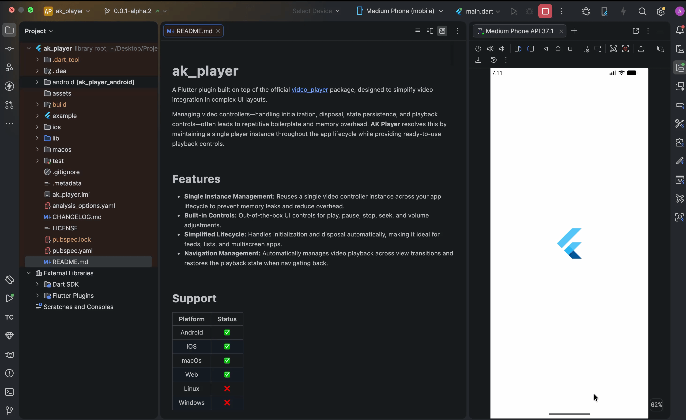
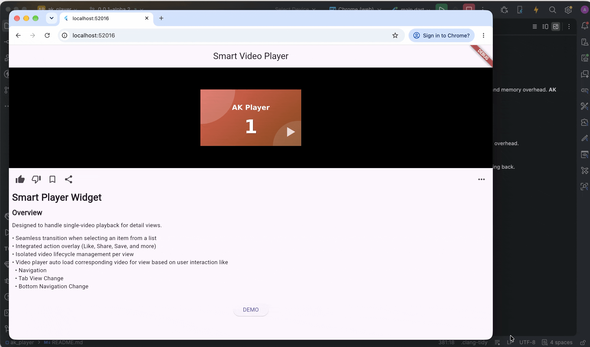
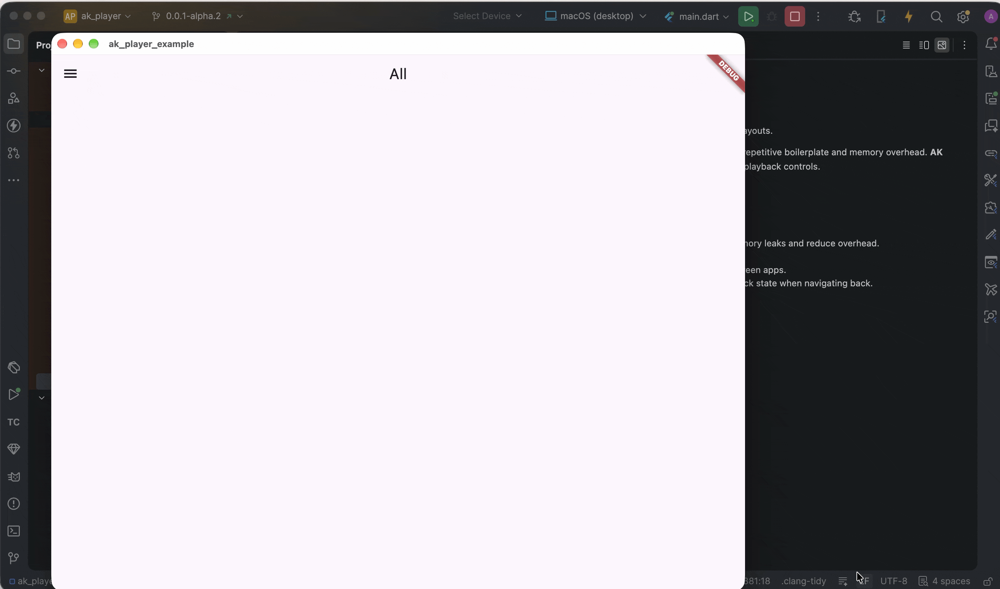

# ak_player

A Flutter plugin built on top of the official [video_player](https://pub.dev/packages/video_player) package, designed to simplify video integration in complex UI layouts.

Managing video controllers—handling initialization, disposal, state persistence,
and playback controls—often leads to repetitive boilerplate and memory overhead.
**AK Player** resolves this by maintaining a single player instance throughout the
app lifecycle while providing ready-to-use playback controls.

## Features
- **Single Instance Management:** Reuses a single video controller instance across your app lifecycle to prevent memory leaks and reduce overhead.
- **Built-in Controls:** Out-of-the-box UI controls for play, pause, stop, seek, and volume adjustments.
- **Simplified Lifecycle:** Handles initialization and disposal automatically, making it ideal for feeds, lists, and multiscreen apps.
- **Navigation Management:** Automatically manages video playback across view transitions and restores the playback state when navigating back.

## Support
| Platform | Status |
|:--------:|:------:|
| Android  |   ✅   |
|   iOS    |   ✅   |
|  macOs   |   ✅   |
|   Web    |   ✅   |
|  Linux   |   ❌   |
| Windows  |   ❌   |

# Plugin Setup
Add both packages into pubspec.yaml
> ak_player:^latest  
> video_player: ^latest

## Permission Required
### 1. Android
- Add into AndroidManifest.xml
```
<uses-permission android:name="android.permission.INTERNET" />
```
### 2. iOS (Optional)
- Add into Info.plist
```
<key>NSAppTransportSecurity</key>
<dict>
    <key>NSAllowsArbitraryLoadsForMedia</key>
    <true/>
</dict>  
```
```
<key>CADisableMinimumFrameDurationOnPhone</key>
<true/>
```
```
<key>UIApplicationSceneManifest</key>
<dict>
	<key>UIApplicationSupportsMultipleScenes</key>
	<false/>
	<key>UISceneConfigurations</key>
	<dict>
		<key>UIWindowSceneSessionRoleApplication</key>
		<array>
			<dict>
				<key>UISceneClassName</key>
				<string>UIWindowScene</string>
				<key>UISceneConfigurationName</key>
				<string>flutter</string>
				<key>UISceneDelegateClassName</key>
				<string>FlutterSceneDelegate</string>
				<key>UISceneStoryboardFile</key>
				<string>Main</string>
			</dict>
		</array>
	</dict>
</dict>
<key>UIApplicationSupportsIndirectInputEvents</key>
<true/>
```
### 3. macOS
- Add into Release.entitlements and DebugProfile.entitlements
```
<plist version="1.0">
<dict>
    <!-- Enables macOS App Sandbox -->
    <key>com.apple.security.app-sandbox</key>
    <true/>

    <!-- Allows outgoing network calls (HTTP/HTTPS/Sockets) -->
    <key>com.apple.security.network.client</key>
    <true/>
</dict>
</plist>
```
- Add into Info.plist
```
<key>NSPrincipalClass</key>
<string>NSApplication</string>
<key>NSAppTransportSecurity</key>
<dict>
    <key>NSAllowsArbitraryLoads</key>
    <true/>
</dict>
```

## Navigation Handler
### NavigationController
Acts as a state store to preserve and restore video playback data across navigation stack changes.
To enable this, register the controller inside the `navigatorObservers` property of your `MaterialApp`.
```
return MaterialApp(
   navigatorObservers: [NavigationController()], // --> Add this controller initialization
   home: Scaffold(
   appBar: AppBar(title: const Text('Smart Video Player')),
   body: Builder(
   .
   .
   .
```

## Widgets
### 1. AKPlayer
A standard player widget designed for single video playback within a view.

### AKPlayer Properties

| Property                    |            Type            |          Example Value          | Description                                                                             |
|:----------------------------|:--------------------------:|:-------------------------------:|:----------------------------------------------------------------------------------------|
| **key**                     |         `ValueKey`         |     ValueKey("unique_key")      | Unique identifier for each video.                                                       |
| **height**                  |          `double`          |              120.0              | Height of the player widget.                                                            |
| **width**                   |          `double`          |              360.0              | Width of the player widget.                                                             |
| **debugLabelText**          |          `String`          |         'feed_video_1'          | Unique label used to identify the video in debug logs.                                  |
| **thumbnailUrl**            |         `String?`          | 'https://example.com/file.jpeg' | Thumbnail image displayed while the player is idle. *(Optional)*                        |
| **videoUrl**                |          `String`          | 'https://example.com/file.mp4'  | Source URL or file path for the video.                                                  |
| **isAsset**                 |          `bool?`           |              false              | Set to `true` if loading the video from local asset bundle. *(Optional)*                |
| **playMode**                |        `PlayMode?`         |          PlayMode.auto          | Controls whether the video plays automatically or requires manual trigger. *(Optional)* |
| **lastWatchedState**        |    `LastWatchedState?`     |      LastWatchedState.save      | Saves playback duration to resume from the last position upon returning. *(Optional)*   |
| **looping**                 |          `bool?`           |              false              | Automatically restarts playback when the video ends. *(Optional)*                       |
| **onVideoError**            |    `Function(dynamic)?`    |     (error) => print(error)     | Callback invoked when a video loading or playback error occurs. *(Optional)*            |
| **onImageError**            |    `Function(dynamic)?`    |     (error) => print(error)     | Callback invoked when a thumbnail image fails to load. *(Optional)*                     |
| **borderRadius**            |  `BorderRadiusGeometry?`   |   BorderRadius.circular(8.0)    | Border radius applied to the player container. *(Optional)*                             |
| **muteConfig**              |       `MuteConfig?`        |          MuteConfig()           | Configuration for volume and mute behaviors. *(Optional)*                               |
| **durationConfig**          |     `DurationConfig?`      |        DurationConfig()         | Configuration for duration display and text styling. *(Optional)*                       |
| **seekBarConfig**           |      `SeekBarConfig?`      |         SeekBarConfig()         | Configuration for seek bar appearance and behavior. *(Optional)*                        |
| **videoConfig**             |       `VideoConfig?`       |          VideoConfig()          | General configuration settings for video playback. *(Optional)*                         |
| **loadingIndicationConfig** | `LoadingIndicationConfig?` |    LoadingIndicationConfig()    | Configuration for the loading spinner and buffer indicators. *(Optional)*               |
| **thumbnailConfig**         |     `ThumbnailConfig?`     |        ThumbnailConfig()        | Configuration for thumbnail display, fit, imageRepeat and filterQuality. *(Optional)*   |

### Sample Code
```
AKPlayer(
    key: ValueKey("main_screen"), // --> Unique Key for entire app
    videoUrl: VideoUrls.landscapeVideo,
    debugLabelText: "main_screen",
    width: double.infinity,
    thumbnailUrl: ImageUrls.landscapeImages[8],
    playMode: PlayMode.auto,
    lastWatchedState: LastWatchedState.save,
    looping: true,
    height: 250
)
```
### Sample Output


### 2. AKListItem with AKListPlayer
Designed for video playback inside scrollable views (such as `ListView`).
Lightweight thumbnail images load first to ensure smooth scrolling performance,
and videos autoplay automatically based on viewport visibility and scroll interaction.

### AKListItem Properties

| Property     |    Type    |        Example Value        | Description                                                       |
|:-------------|:----------:|:---------------------------:|:------------------------------------------------------------------|
| **key**      | `ValueKey` |   ValueKey('unique_key')    | Unique identifier for each video item.                            |
| **duration** | `Duration` | Duration(milliseconds: 200) | Transition delay when switching from thumbnail to video playback. |
| **isFirst**  |   `bool`   |            false            | Set to `true` for the first item in the list.                     |
| **isLast**   |   `bool`   |            false            | Set to `true` for the last item in the list.                      |
| **child**    |  `Widget`  |      AKListPlayer(...)      | Child widget, typically `AKListPlayer`.                           |

### AKListPlayer Properties

| Property                    |            Type            |          Example Value          | Description                                                                           |
|:----------------------------|:--------------------------:|:-------------------------------:|:--------------------------------------------------------------------------------------|
| **height**                  |          `double`          |              120.0              | Height of the player widget.                                                          |
| **width**                   |          `double`          |              360.0              | Width of the player widget.                                                           |
| **debugLabelText**          |          `String`          |         'feed_video_1'          | Unique label used to identify the video in debug logs.                                |
| **thumbnailUrl**            |          `String`          | 'https://example.com/file.jpeg' | Thumbnail image displayed while the player is idle.                                   |
| **videoUrl**                |          `String`          | 'https://example.com/file.mp4'  | Source URL or file path for the video.                                                |
| **isAsset**                 |          `bool?`           |              false              | Set to `true` if loading the video from local asset bundle. *(Optional)*              |
| **lastWatchedState**        |    `LastWatchedState?`     |      LastWatchedState.save      | Saves playback duration to resume from the last position upon returning. *(Optional)* |
| **looping**                 |          `bool?`           |              false              | Automatically restarts playback when the video ends. *(Optional)*                     |
| **onVideoError**            |    `Function(dynamic)?`    |     (error) => print(error)     | Callback invoked when a video loading or playback error occurs. *(Optional)*          |
| **onImageError**            |    `Function(dynamic)?`    |     (error) => print(error)     | Callback invoked when a thumbnail image fails to load. *(Optional)*                   |
| **borderRadius**            |  `BorderRadiusGeometry?`   |   BorderRadius.circular(8.0)    | Border radius applied to the player container. *(Optional)*                           |
| **muteConfig**              |       `MuteConfig?`        |          MuteConfig()           | Configuration for volume and mute behaviors. *(Optional)*                             |
| **durationConfig**          |     `DurationConfig?`      |        DurationConfig()         | Configuration for duration display and text styling. *(Optional)*                     |
| **seekBarConfig**           |      `SeekBarConfig?`      |         SeekBarConfig()         | Configuration for seek bar appearance and behavior. *(Optional)*                      |
| **videoConfig**             |       `VideoConfig?`       |          VideoConfig()          | General configuration settings for video playback. *(Optional)*                       |
| **loadingIndicationConfig** | `LoadingIndicationConfig?` |    LoadingIndicationConfig()    | Configuration for the loading spinner and buffer indicators. *(Optional)*             |
| **thumbnailConfig**         |     `ThumbnailConfig?`     |        ThumbnailConfig()        | Configuration for thumbnail display, fit, repeat, and filter quality. *(Optional)*    |
| **onClickListItem**         |      `VoidCallback?`       |     () => print('Clicked')      | Callback triggered when the list item is tapped.                                      |

### Sample Code
```
ListView.builder(
    itemCount: ImageUrls.landscapeListImages.length,
    itemBuilder: (context, index) {
        final itemKey = ValueKey("list_screen_$index");
        return Column(
            children: [
                AKListItem(
                itemKey: itemKey,
                isFirst: index == 0,
                isLast: index == ImageUrls.landscapeListImages.length - 1,
                duration: const Duration(milliseconds: 200),
                    child: AKListPlayer(
                        key: itemKey,
                        videoUrl: VideoUrls.landscapeVideo,
                        thumbnailUrl: ImageUrls.landscapeListImages[index],
                        debugLabelText: 'Video $index',
                        height: 240,
                        width: double.infinity,
                        lastWatchedState: LastWatchedState.save,
                        looping: false,
                        onClickListItem: () {
                            debugPrint('Tapped on Video $index');
                        },
                    ),
                ),
            ],
        );
    },
)
```
### Sample Output Layout - TabView, BottomNav, ListView and BottomSheet


### 3. AKGridItem with AKGridPlayer
Designed for video playback inside scrollable views (such as `GridView`). Lightweight thumbnail images load first to ensure smooth scrolling performance,
and videos autoplay automatically based on viewport visibility and scroll interaction.

### AKGridItem Properties

| Property             |     Type     |        Example Value        | Description                                                                                                          |
|:---------------------|:------------:|:---------------------------:|:---------------------------------------------------------------------------------------------------------------------|
| **key**              |  `ValueKey`  |   ValueKey('unique_key')    | Unique identifier for each video item.                                                                               |
| **index**            |    `int`     |              0              | Position index of the item within the grid.                                                                          |
| **gridConfig**       | `GridConfig` |       GridConfig(...)       | Grid configuration defining properties like `itemCount`, `padding`, and `crossAxisCount` etc.                        |
| **settleDuration**   |  `Duration`  | Duration(milliseconds: 200) | Transition delay before switching from thumbnail to video playback after scrolling settles.                          |
| **stepExtent**       |   `double`   |            50.0             | Vertical scroll distance required to advance the active video across columns within the same row.                    |
| **visibleThreshold** |   `double`   |             0.8             | Fraction of the item height (`0.0` to `1.0`) that must be visible in the viewport to activate playback. *(Optional)* |
| **child**            |   `Widget`   |      AKGridPlayer(...)      | Child widget, typically `AKGridPlayer`.                                                                              |

### AKGridPlayer Properties

| Property                    |            Type            |          Example Value          | Description                                                                           |
|:----------------------------|:--------------------------:|:-------------------------------:|:--------------------------------------------------------------------------------------|
| **height**                  |          `double`          |              120.0              | Height of the player widget.                                                          |
| **width**                   |          `double`          |              360.0              | Width of the player widget.                                                           |
| **debugLabelText**          |          `String`          |         'feed_video_1'          | Unique label used to identify the video in debug logs.                                |
| **thumbnailUrl**            |          `String`          | 'https://example.com/file.jpeg' | Thumbnail image displayed while the player is idle.                                   |
| **videoUrl**                |          `String`          | 'https://example.com/file.mp4'  | Source URL or file path for the video.                                                |
| **isAsset**                 |          `bool?`           |              false              | Set to `true` if loading the video from local asset bundle. *(Optional)*              |
| **lastWatchedState**        |    `LastWatchedState?`     |      LastWatchedState.save      | Saves playback duration to resume from the last position upon returning. *(Optional)* |
| **looping**                 |          `bool?`           |              false              | Automatically restarts playback when the video ends. *(Optional)*                     |
| **onVideoError**            |    `Function(dynamic)?`    |     (error) => print(error)     | Callback invoked when a video loading or playback error occurs. *(Optional)*          |
| **onImageError**            |    `Function(dynamic)?`    |     (error) => print(error)     | Callback invoked when a thumbnail image fails to load. *(Optional)*                   |
| **borderRadius**            |  `BorderRadiusGeometry?`   |   BorderRadius.circular(8.0)    | Border radius applied to the player container. *(Optional)*                           |
| **muteConfig**              |       `MuteConfig?`        |          MuteConfig()           | Configuration for volume and mute behaviors. *(Optional)*                             |
| **durationConfig**          |     `DurationConfig?`      |        DurationConfig()         | Configuration for duration display and text styling. *(Optional)*                     |
| **seekBarConfig**           |      `SeekBarConfig?`      |         SeekBarConfig()         | Configuration for seek bar appearance and behavior. *(Optional)*                      |
| **videoConfig**             |       `VideoConfig?`       |          VideoConfig()          | General configuration settings for video playback. *(Optional)*                       |
| **loadingIndicationConfig** | `LoadingIndicationConfig?` |    LoadingIndicationConfig()    | Configuration for the loading spinner and buffer indicators. *(Optional)*             |
| **thumbnailConfig**         |     `ThumbnailConfig?`     |        ThumbnailConfig()        | Configuration for thumbnail display, fit, repeat, and filter quality. *(Optional)*    |
| **onClickGridItem**         |      `VoidCallback?`       |     () => print('Clicked')      | Callback triggered when the grid item is tapped.                                      |

### Sample Code
```
final gridConfig = GridConfig(
    itemCount: ImageUrls.portraitListImages.length,
    crossAxisCount: 2,
    childAspectRatio: 9 / 16,
    mainAxisSpacing: 4,
    crossAxisSpacing: 4,
);

GridView.builder(
    padding: gridConfig.padding,
    itemCount: gridConfig.itemCount,
    gridDelegate: SliverGridDelegateWithFixedCrossAxisCount(
        crossAxisCount: gridConfig.crossAxisCount,
        mainAxisSpacing: gridConfig.mainAxisSpacing,
        crossAxisSpacing: gridConfig.crossAxisSpacing,
        childAspectRatio: gridConfig.childAspectRatio,
        mainAxisExtent: gridConfig.mainAxisExtent,
    ),
    itemBuilder: (context, index) {
        final itemKey = ValueKey("grid_screen_$index");
        return AKGridItem(
        itemKey: itemKey,
        index: index,
        gridConfig: gridConfig,
        stepExtent: 90,
        child: LayoutBuilder(
            builder: (context, boxConstraints) {
            return AKGridPlayer(
                key: itemKey,
                videoUrl: VideoUrls.portraitVideo,
                thumbnailUrl: ImageUrls.portraitListImages[index],
                debugLabelText: 'Video $index',
                height: boxConstraints.maxHeight,
                width: boxConstraints.maxWidth,
                lastWatchedState: LastWatchedState.save,
                looping: false,
                onClickGridItem: () {
                    debugPrint('Tapped on Video $index');
                  },
                );
              },
            ),
        );
    },
)
```
### Sample Output


### 4. AKWebMacosGridPlayer
A player widget designed exclusively for Web and macOS that automatically starts video playback when the cursor hovers over a grid item.
It is typically wrapped inside a `GridView` combined with a `LayoutBuilder`.

### AKWebMacosGridPlayer Properties

| Property                    |            Type            |          Example Value          | Description                                                                           |
|:----------------------------|:--------------------------:|:-------------------------------:|:--------------------------------------------------------------------------------------|
| **height**                  |          `double`          |    boxConstraints.maxHeight     | Height of the player widget.                                                          |
| **width**                   |          `double`          |     boxConstraints.maxWidth     | Width of the player widget.                                                           |
| **debugLabelText**          |          `String`          |         'feed_video_1'          | Unique label used to identify the video in debug logs.                                |
| **thumbnailUrl**            |          `String`          | 'https://example.com/file.jpeg' | Thumbnail image displayed while the player is idle.                                   |
| **videoUrl**                |          `String`          | 'https://example.com/file.mp4'  | Source URL or file path for the video.                                                |
| **isAsset**                 |          `bool?`           |              false              | Set to `true` if loading the video from local asset bundle. *(Optional)*              |
| **lastWatchedState**        |    `LastWatchedState?`     |      LastWatchedState.save      | Saves playback duration to resume from the last position upon returning. *(Optional)* |
| **looping**                 |          `bool?`           |              false              | Automatically restarts playback when the video ends. *(Optional)*                     |
| **onVideoError**            |    `Function(dynamic)?`    |     (error) => print(error)     | Callback invoked when a video loading or playback error occurs. *(Optional)*          |
| **onImageError**            |    `Function(dynamic)?`    |     (error) => print(error)     | Callback invoked when a thumbnail image fails to load. *(Optional)*                   |
| **borderRadius**            |  `BorderRadiusGeometry?`   |   BorderRadius.circular(8.0)    | Border radius applied to the player container. *(Optional)*                           |
| **muteConfig**              |       `MuteConfig?`        |          MuteConfig()           | Configuration for volume and mute behaviors. *(Optional)*                             |
| **durationConfig**          |     `DurationConfig?`      |        DurationConfig()         | Configuration for duration display and text styling. *(Optional)*                     |
| **seekBarConfig**           |      `SeekBarConfig?`      |         SeekBarConfig()         | Configuration for seek bar appearance and behavior. *(Optional)*                      |
| **videoConfig**             |       `VideoConfig?`       |          VideoConfig()          | General configuration settings for video playback. *(Optional)*                       |
| **loadingIndicationConfig** | `LoadingIndicationConfig?` |    LoadingIndicationConfig()    | Configuration for the loading spinner and buffer indicators. *(Optional)*             |
| **thumbnailConfig**         |     `ThumbnailConfig?`     |        ThumbnailConfig()        | Configuration for thumbnail display, fit, repeat, and filter quality. *(Optional)*    |
| **onClickGridItem**         |      `VoidCallback?`       |     () => print('Clicked')      | Callback triggered when the grid item is tapped.                                      |

### Sample Code
```
GridView.builder(
    itemCount: ImageUrls.portraitListImages.length,
    gridDelegate: SliverGridDelegateWithFixedCrossAxisCount(
        crossAxisCount: 4,
        mainAxisSpacing: 4,
        crossAxisSpacing: 4,
        childAspectRatio: 16 / 9
    ),
    itemBuilder: (context, index) {
        final itemKey = ValueKey("grid_screen_web_mac_$index");
        return LayoutBuilder(
        builder: (context, boxConstraints) {
        return AKWebMacosGridPlayer(
            key: itemKey,
            videoUrl: VideoUrls.landscapeVideo,
            thumbnailUrl: ImageUrls.landscapeListImages[index],
            debugLabelText: 'Video $index',
            height: boxConstraints.maxHeight,
            width: boxConstraints.maxWidth,
            onClickGridItem: () {
                debugPrint('Tapped on Video $index');
            },
            onVideoError: (error) {
                debugPrint('Error: $error');
            },
              );
            },
        );
    },
)
```
### Sample Output - Web


### Sample Output - MacOs
